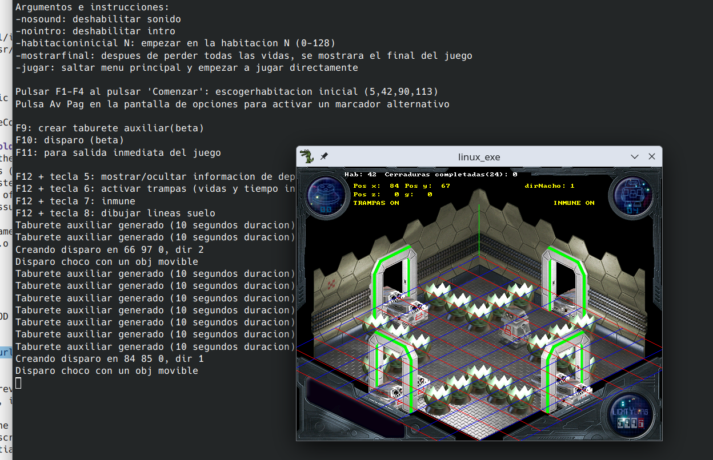

# Recompilación y actualización del remake de Alien 8 de Ignacio Perez Gil y D-o-S (2008) para Retrospec

Autor de la recompilación y actualización: Basuradeluis (2026 y 2016).


Basado en:  
Código fuente:
https://retrospec.sgn.net/info.htm?id=alien8&t=g  
Motor Isomot:
https://retrospec.sgn.net/info.htm?id=isomot&t=u  



## Acerca de
Alien 8 fue un videojuego desarrollado por Ultimate para ordenadores en los 80. En 2008, Ignacio Perez Gil y D-o-S hicieron un remake para Windows, Mac y Linux escrito en C con la librería Allegro.  
En 2016 hice algunos experimentos con el juego por diversión. Y en 2026 los recuperé.  
Estos son sólo algunos pequeños cambios en el código, con algunas instrucciones al respecto.  
El código fuente original estaba en español, aunque hay algunos trucos para hacer que las funciones estén disponibles en inglés (los DEFINEs en Isomot).  
Descarga el código fuente y la versión de Windows (y la versión de Fedora quizás) de la página de Retrospec. O usa la que se proporciona aquí, son copias de ellas.  

alien8_win/  
isomot/  

## Acerca del motor (Isomot):
Mira la carpeta demo de Isomot y su html. El código fuente se puede descargar desde aquí (https://retrospec.sgn.net/info.htm?id=isomot&t=u)  
El original precompilado exe para windows corre demasiado rápido en un Wine bajo Linux moderno con CPUs. Y bajo Linux incluso recompilado, probablemente porque no tiene límite de FPS/velocidad.  

Para compilarlos bajo Linux, copia los archivos de Isomot (.c .h y ism_lng.h) junto a los archivos .c de demo (o viceversa).  
Después compila los .c con:  

```bash
gcc -c demoesp.c isomot.c
```

Después enlaza los .o, añadiendo la librería matemática (porque se usa la función de resto flotante fmod):  

```bash
gcc *.o -o salida  -lalleg  -lm
```  

## Instrucciones para compilar el juego  
Se necesita la librería de desarrollo de Allegro 4. También la librería curl (el juego tiene una opción para enviar puntuaciones a internet, aunque ya no funciona). Usa el administrador de paquetes de tu distribución para instalarlas. Como:  

```bash
sudo apt install liballegro4-dev build-essential libasound2-dev libcurl4-openssl-dev
```  

Para el sonido se usa la librería [FMOD library](https://www.fmod.com). Para descargarla, regístrate en la página web de FMOD y descarga el FMOD Engine (para la Core API). Descarga la versión 2.03.15 para Linux. Otras versiones puede que funcionen también. Ten en cuenta que algunas librerías FMOD pueden necesitar pequeños cambios.  

Después haz lo siguiente:  

```bash
sudo cp api/core/inc/* /usr/local/include/  
sudo cp api/core/lib/x86_64/* /usr/local/lib/  
sudo ldconfig
```  

Ignora el mensaje "this is not a symbolic link", o quita los ficheros .14 y .15 y crea enlaces simbólicos al archivo .so principal. Quizás este paso sea innecesario o haya otras formas de usar la librería. Google o cualquier IA puede ayudar.  

Mira también las etiquetas de git 'OriginalSourceCode' y 'FMODFixes'.  

## Algunos cambios al código original para compilarlo:  
- Arreglos en el archivo internet.c para usar la versión de Linux de curl según tu Sistema Operativo (internet.c tiene un #DEFINE para los distintos SO)  
- Arreglos de algunos problemas de librerías FMOD viejas (mira el tag 'FMODFixes' en el historial de git)  
    Añadir FMOD_VERSION in  FMOD_System_Create(&sistema, FMOD_VERSION);  
    Y otros arreglos debido a cambios en la librería FMOD  
- Arreglos en juego.c con algunos problemas de C/C++. Lvalues y Rvalues. Undef no tiene parametros  

Sugerencias para compilar el juego:  
Primero compila los .c en .o:  

```bash
gcc -c *.c
```  

Después, enlaza los .o con Allegro, FMOD y curl:  

```bash
gcc *.o -o linux_exe -lalleg -lcurl -lfmod
```  

Puedes crear alias para estos comandos anteriores. O ajusta tu IDE o haz un makefile si es necesario.  
Ejecuta el ejecutable en una terminal, si es posible.  

Los archivos .dat deben estar junto al ejecutable generado. Si no existen y el modo de pantalla completa está activado, probablemente se vea una pantalla negra sin error. En Linux, usa Ctrl+Alt+F3 para parar el programa. Vuelve a la pantalla inicial (Ctrl+Alt+F2) y reajusta la resolución de pantalla.  
Adapté el juego, para que si no existe una configuración inicial, use el modo ventana por defecto (para evitar problemas con resoluciones mayores y pantallas negras).  

El archivo anims.dat fue modificado añadiendo algunas imágenes extra (aunque no todas se usan). Usa el .dat incluido en este paquete.  
Puedes usar el programa grabber (instalado con el paquete de desarrollo de Allegro) para examinar/modificar los archivos .dat. Algunas de las imágenes/fuentes de estos .dat han sido extraídas en la carpeta 'extradata/miniaturas/'.  

## Características agregadas:
- Se pasan argumentos al programa y se muestra ayuda sobre algunos argumentos y teclas.  
- Algunos trucos (el de vidas infinitas ya existía). Vidas infinitas y tiempo. Inmunidad  
- Elige la habitación inicial mediante argumento (anteriormente había algo similar usando las teclas F1-F4).  
- Salta la intro y el menu para ir al juego al instante.  
- Mostrar el final del juego.  
- Saltar al juego al instante.  
- Información de depuración (habitacion actual, lineas dibujadas en el suelo).  
- Habilidad de hacer aparecer un bloque temporal auxiliar para facilitar los saltos.  
- ¡Ahora puedes disparar!
