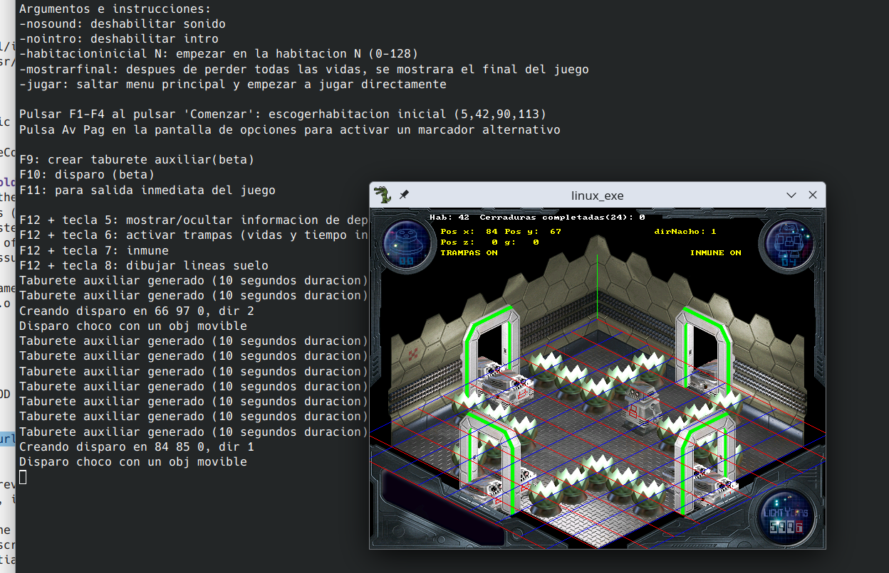

# Recompilation and Update of Alien 8 remake by Ignacio Perez Gil and D-o-S (2008) for Retrospec

Author of the Recompilation and Update: Basuradeluis (2026 and 2016).


Based on:  
Source:
https://retrospec.sgn.net/info.htm?id=alien8&t=g  
Isomot engine:
https://retrospec.sgn.net/info.htm?id=isomot&t=u



## About
Alien 8 was a video game developed by Ultimate for computers in the 80's. In 2008 Ignacio Perez Gil and D-o-S made a remake for the [Retrospec webpage](https://retrospec.sgn.net/info.htm?id=alien8&t=g) for Windows, Mac and Linux written in C with Allegro library.  
In 2016 I made some experiments with it just for fun, and in 2026 I recovered them.  
These are just some little changes to the code, with some instructions about it.  
The original source code was in Spanish, although there are some tricks to make functions available in English (see the DEFINEs in Isomot).  
Download both source code AND windows version (and maybe the Fedora version too) from the Retrospec webpage. Or use the ones provided here; they are copies of them.  
alien8_win/
isomot/

## About the Engine (Isomot):
See Isomot demo folder and its html. The source code can be downloaded from [here](https://retrospec.sgn.net/info.htm?id=isomot&t=u).  
The provided original precompiled executable for Windows runs too fast on a Wine under Linux with modern CPUs. Under Linux, even when recompiled, it probably runs too fast because it has no FPS/speed limit.

To compile them under Linux, copy the Isomot files (.c, .h and ism_lng.h) next to .c demo files (or vice versa).
Then, compile the .c files with:

```bash
gcc -c demoesp.c isomot.c
```

Then link them, adding the math library (because the fmod floating-point remainder function is used):

```bash
gcc *.o -o linux_exe  -lalleg  -lm
```


## Instructions to compile the game
Library Allegro 4 development files are needed. Also the curl library (the game has an option to send scores to the internet, although it doesn't work anymore). Use your distribution package manager to install them. Like:

```bash
sudo apt install liballegro4-dev build-essential libasound2-dev libcurl4-openssl-dev
```

Also the sound uses the [FMOD library](https://www.fmod.com). To download it, just register in FMOD web page, and download the FMOD Engine (for the Core API). I downloaded the 2.03.15 version for Linux. Other version may work. Keep in mind some FMOD library may have little changes. You may have to adapt some code to FMOD.

Then do the following:

```bash
sudo cp api/core/inc/* /usr/local/include/
sudo cp api/core/lib/x86_64/* /usr/local/lib/
sudo ldconfig
```

Ignore the "this is not a symbolic link" message, or remove the .14 and .15 files and create symlinks to the main .so file. Maybe this step is unnecessary or there are other ways to use the library. Google/any AI may help you.

See also the git tags 'OriginalSourceCode' and 'FMODFixes'.

## Some updates to the original code to compile it:
- Fix the internet.c file to use the Linux version of curl according to your Operating System (internet.c has a #DEFINE for different OS)
- Fix some old fmod library issues (see tag 'FMODFixes' in git history)
    Add FMOD_VERSION in  FMOD_System_Create(&sistema, FMOD_VERSION);
    Others adaptations depending of Fmod library changes
- Fix juego.c with some C / CPP issues. Lvalues and Rvalues. Undef has no parameters

As a suggestion to compile the game:
First compile the .c files into .o files:

```bash
gcc -c *.c
```

Then, link them with Allegro, FMOD and curl:

```bash
gcc *.o -o linux_exe -lalleg -lcurl -lfmod
```

You may create alias for these previous commands. Or adjust you IDE or make a makefile if necessary.
Run the executable in a terminal, if possible.

The .dat files must be next to the generated executable. If they aren't there and full screen mode enabled, probably a black screen with no error will be shown. In Linux, use Ctrl+Alt+F3 to kill the program. Go back to initial (Ctrl+Alt+F2) and readjust your screen resolution.
I changed the game, so if there is no initial configuration, it uses window mode as the default (to prevent issues with higher resolutions and black screens).

The anims.dat file was modified adding some extra images (although not all are used). Use the included in this package.
You may use grabber program (installed with Allegro library development package) to examine/modify the dat files. Some of the images/fonts of this .dat files were extracted into 'extradata/miniaturas/' folder.


## Features added:
- Arguments passed to the program, and help about some key bindings.
- Some cheats (immunity was already present). Infinite lives and time.
- Choose the initial room via argument (previously there was something similar using F1-F4 keys).
- Skip intro, and skip menu, to go to play the game instantly.
- Show the end sequence.
- Quit the game instantly.
- Debug info (current room, lines drawn on the floor).
- Ability to appear an auxiliary temporary block to make jumps easier.
- Ability to shoot!

